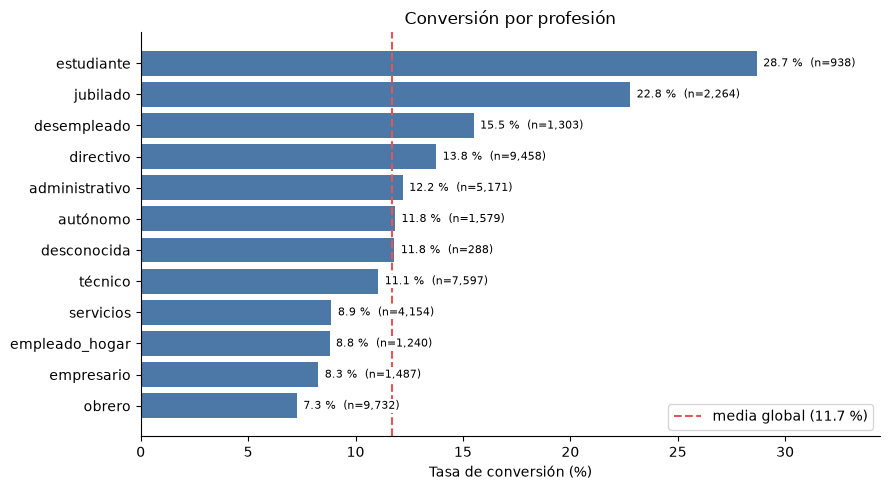
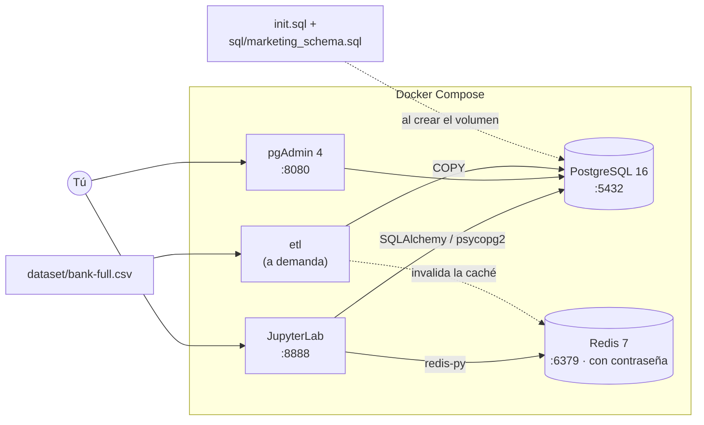
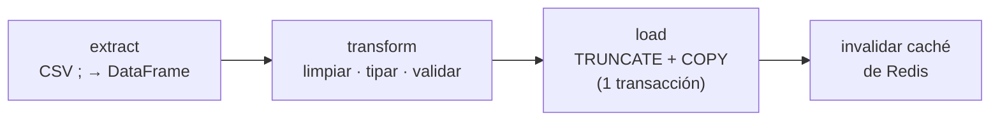
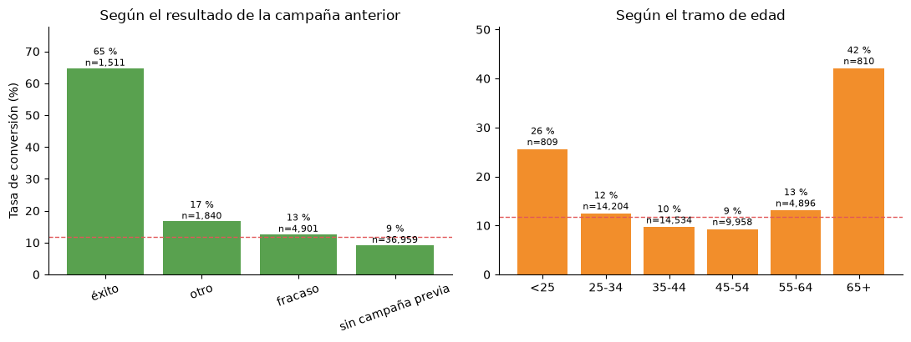
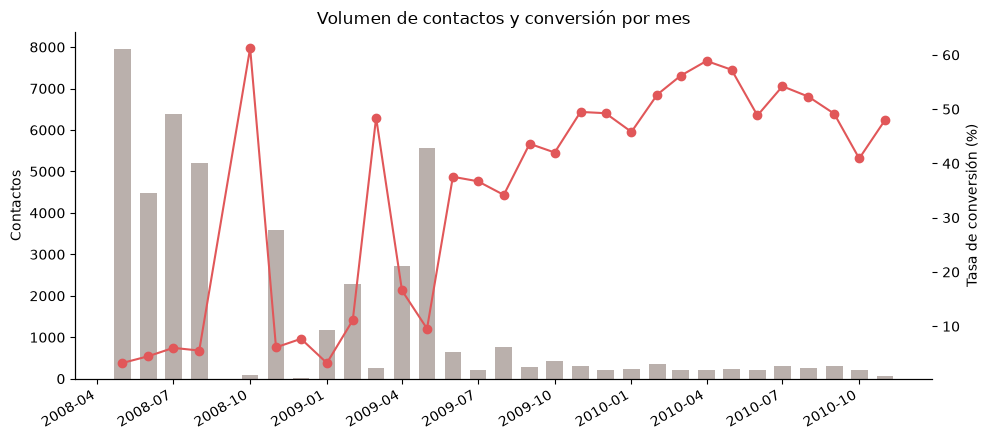

# Entorno de datos reproducible con Docker: ETL + PostgreSQL + Redis + Jupyter

[](https://github.com/josuehormigabenitez22-cmd/proyecto-docker-database/actions/workflows/ci.yml)

Entorno local de ingeniería y análisis de datos que se levanta con un solo comando (PostgreSQL, Redis, JupyterLab y pgAdmin con Docker Compose) y que incluye un **pipeline ETL en Python** que carga un dataset real de 45.211 registros, una caché de consultas en Redis y notebooks de análisis con gráficos.



## Objetivo

Disponer de una base reproducible para prototipar pipelines de datos sin instalar nada en la máquina local: cualquiera que clone el repositorio obtiene el mismo entorno, con una base de datos inicializada, un ETL listo para ejecutar y el análisis ya hecho.

**Caso de uso:** analizar qué clientes de una campaña de telemarketing bancario contratan un depósito a plazo ([UCI Bank Marketing](https://archive.ics.uci.edu/dataset/222/bank+marketing)): extraer el CSV -> limpiarlo con pandas -> cargarlo en PostgreSQL -> consultarlo con SQL analítico (con Redis como caché) -> visualizarlo en Jupyter.

## Arquitectura



| Servicio | Imagen | Puerto local | Función |
|---|---|---|---|
| `postgres` | `postgres:16.14` | 5432 | Base de datos relacional, inicializada con datos de ejemplo |
| `redis` | `redis:7.4.10-alpine` | 6379 | Caché de consultas, con contraseña y persistencia AOF |
| `jupyter` | `quay.io/jupyter/scipy-notebook:2026-07-28` (+ drivers) | 8888 | Análisis en Python (pandas, matplotlib, SQLAlchemy…) |
| `pgadmin` | `dpage/pgadmin4:9.16` | 8080 | Interfaz web para administrar PostgreSQL |
| `etl` | `python:3.12-slim` (+ dependencias) | — | Ejecuta el ETL y los tests; **no arranca con `up`**, se lanza a demanda |

## Características

- **Un comando** para levantar todo el entorno.
- **Versiones de imagen fijadas** (sin `latest`) y dependencias Python con versión exacta (`requirements.txt`).
- **Pipeline ETL** en `src/etl/` (extract → transform → load): limpieza con pandas, validación de rangos, carga masiva con `COPY` en una transacción (si falla, la tabla conserva los datos anteriores) y ejecución idempotente.
- **Caché de consultas en Redis** (`src/cache.py`): serialización JSON con TTL, claves por hash de consulta + parámetros, invalidación automática tras cada carga del ETL y degradación segura si Redis no responde.
- **Consultas analíticas con nombre** (`sql/analytics.sql`): `JOIN`, `LEFT JOIN`, CTE, funciones de ventana, `GROUP BY CUBE`, percentiles.
- **3 notebooks** ejecutados, con sus salidas y gráficos.
- **Tests automáticos** (89) y **CI con GitHub Actions**.
- **Healthchecks** en PostgreSQL y Redis: JupyterLab y el ETL solo arrancan cuando ambas bases están listas; pgAdmin espera a PostgreSQL.
- **Sin secretos en el código**: credenciales en `.env` (excluido de Git) con `.env.example` como plantilla. Redis exige contraseña.
- **Puertos expuestos solo en `127.0.0.1`**, no accesibles desde la red.

## Estructura

```
proyecto-docker-database/
├── docker-compose.yml          # 4 servicios + etl (perfil opcional)
├── docker/
│   ├── jupyter/Dockerfile      # Jupyter + psycopg2 + redis (versiones de requirements.txt)
│   └── app/Dockerfile          # Imagen ligera para ETL y tests
├── init.sql                    # Tienda de demostración: clientes, productos, pedidos, detalle_pedidos
├── sql/
│   ├── marketing_schema.sql    # Esquema marketing.contactos (lo usa el ETL)
│   └── analytics.sql           # Consultas analíticas con nombre
├── src/
│   ├── config.py               # Configuración desde variables de entorno
│   ├── cache.py                # Caché de consultas en Redis + benchmark
│   ├── queries.py              # Carga de consultas por nombre
│   └── etl/                    # extract.py · transform.py · load.py · pipeline.py · __main__.py
├── notebooks/
│   ├── 01_prueba_postgresql.ipynb   # Prueba de conexión a PostgreSQL y Redis
│   ├── 02_eda_clientes.ipynb        # Análisis exploratorio de clientes y pedidos
│   └── 03_marketing_bancario.ipynb  # Análisis del dataset real + benchmark de la caché
├── tests/                      # Unitarios + integración (PostgreSQL y Redis reales)
├── dataset/                    # UCI Bank Marketing (bank-full.csv, bank.csv, bank-names.txt)
├── docs/img/                   # Gráficos usados en este README
├── .github/workflows/ci.yml    # Lint + tests + prueba del stack Docker
├── .env.example                # Plantilla de variables de entorno
├── requirements.txt            # Dependencias de ejecución (versiones fijadas)
└── requirements-dev.txt        # + pytest, fakeredis, ruff
```

## Puesta en marcha

### Requisitos

- [Docker](https://docs.docker.com/get-docker/) con Docker Compose v2 (`docker compose`)

### Pasos

```bash
# 1. Clonar el repositorio
git clone https://github.com/josuehormigabenitez22-cmd/proyecto-docker-database.git
cd proyecto-docker-database

# 2. Crear el archivo de configuración y editar las contraseñas
cp .env.example .env

# 3. Levantar el entorno (la primera vez construye la imagen de Jupyter y descarga las demás: tarda unos minutos)
docker compose up -d

# 4. Comprobar que todo está en marcha
docker compose ps

# 5. Cargar el dataset de marketing en PostgreSQL con el ETL (~2 s)
docker compose run --rm etl
```

### Acceso a los servicios

| Servicio | URL / Conexión | Credenciales |
|---|---|---|
| JupyterLab | http://localhost:8888 | `JUPYTER_TOKEN` del `.env` |
| pgAdmin | http://localhost:8080 | `PGADMIN_EMAIL` / `PGADMIN_PASSWORD` |
| PostgreSQL | `localhost:5432` | `POSTGRES_USER` / `POSTGRES_PASSWORD` / `POSTGRES_DB` |
| Redis | `localhost:6379` | `REDIS_PASSWORD` (`redis-cli -a <contraseña>`) |

> **Registrar PostgreSQL en pgAdmin:** al crear el servidor usa como host `postgres` (nombre del servicio), no `localhost`, porque pgAdmin se conecta desde dentro de la red de Docker.

## Verificar que funciona

1. Abre JupyterLab y entra en la carpeta `work/`.
2. Ejecuta `01_prueba_postgresql.ipynb`: deberías ver 50 clientes, 12 productos, 100 pedidos, 200 líneas de pedido, `marketing.contactos` con 45.211 filas (0 si aún no has lanzado el ETL), el valor `ejecutando` leído desde Redis y la confirmación de que Redis rechaza conexiones sin contraseña.
3. Ejecuta `02_eda_clientes.ipynb` y `03_marketing_bancario.ipynb`.

## Pipeline ETL



```bash
docker compose run --rm etl # bank-full.csv (45.211 filas)
docker compose run --rm etl python -m src.etl --source dataset/bank.csv # muestra del 10 % (4.521 filas)
docker compose run --rm etl python -m src.etl --limit 1000 # solo las 1.000 primeras filas
```

Qué hace la transformación (`src/etl/transform.py`):

| Paso | Detalle |
|---|---|
| Nombres y categorías | Columnas y categorías traducidas al español (`job`→`profesion`, `blue-collar`→`obrero`…) |
| Booleanos | `yes`/`no` → `BOOLEAN` |
| Valores desconocidos | `unknown` → `NULL` en profesión, educación, canal y resultado previo |
| Contacto previo | `pdays = -1` → `NULL` y columna derivada `contactado_antes` |
| **Fecha del contacto** | El CSV solo trae día y mes. `bank-full.csv` está ordenado por fecha (mayo 2008 – noviembre 2010, según `dataset/bank-names.txt`), así que el año se deduce de los saltos de mes. Se exige que el resultado sea cronológico y sin fechas imposibles; en `bank.csv` (muestra aleatoria) no se aplica y la columna queda en `NULL` |
| Validación | Rangos de edad, día, mes, duración…; un valor de categoría no previsto **detiene** el ETL en lugar de cargarse en silencio |

## Caché de consultas con Redis

```python
from src.cache import QueryCache
from src.config import get_engine, get_redis
from src.queries import get_query

engine = get_engine()
cache = QueryCache(get_redis())
sql = get_query("marketing_conversion_cubo")

df = cache.read_sql(engine, sql)  # 1ª vez: PostgreSQL → Redis
df = cache.read_sql(engine, sql)  # siguientes: Redis
```

- Serializa en **JSON** (no `pickle`: deserializar `pickle` de una caché compartida permitiría ejecutar código arbitrario).
- Clave = hash de (SQL normalizado + parámetros), y TTL configurable (`CACHE_TTL_SECONDS`, 300 s por defecto).
- Las columnas `DATE` se devuelven como `datetime64` tanto desde PostgreSQL como desde la caché.
- Si Redis falla (caído, contraseña errónea), se registra un aviso y se consulta PostgreSQL.


## Modelo de datos


### Marketing bancario (`sql/marketing_schema.sql`, esquema `marketing`)

Tabla `marketing.contactos`: un registro por contacto telefónico (el dataset no incluye identificador de cliente, así que `contacto_id` es una clave sustituta). 20 columnas con comentarios (`COMMENT ON`) visibles en pgAdmin: datos del cliente (edad, profesión, saldo, préstamos…), datos del contacto (canal, fecha, duración), historial de campañas previas y la variable objetivo `suscrito`.

## Resultados del análisis

Del notebook `03_marketing_bancario.ipynb` (tasa global de suscripción: **11,70 %**):



- **El historial pesa más que el perfil:** los clientes con una campaña anterior exitosa suscriben el 64,7 %, frente al 9,2 % de quienes no tenían campaña previa.
- **Estudiantes (28,7 %) y jubilados (22,8 %)** convierten muy por encima de la media; obreros (7,3 %), por debajo.
- **Cuidado con las lecturas ingenuas:** los meses con conversión más alta son los de menor volumen (p. ej. 80 contactos en octubre de 2008), lo que sugiere un cambio en la selección de clientes más que estacionalidad.



Son asociaciones sobre datos observacionales, no relaciones causales.

## Tests y CI

```bash
# Con el stack levantado, dentro de Docker (usa PostgreSQL y Redis reales):
docker compose run --rm etl pytest

# O en local (Python 3.11+), con los servicios del compose accesibles en localhost
# y las variables de .env exportadas:
pip install -r requirements-dev.txt
pytest
```

- **Unitarios** (sin servicios): transformaciones, validaciones, caché (con `fakeredis` y SQLite), consultas y configuración.
- **Integración** (`tests/integration/`): `init.sql`, ETL (carga, idempotencia, rollback), las consultas analíticas contrastadas con cálculos independientes en pandas, y la caché contra Redis real, incluida la autenticación.
- Los tests de integración **nunca tocan tu base de datos de trabajo**: crean una base temporal `test_<aleatorio>` y la borran al terminar. Si PostgreSQL o Redis no están disponibles, se saltan (salvo con `REQUIRE_INTEGRATION=1`).
- **GitHub Actions** (`.github/workflows/ci.yml`): lint con `ruff`, tests con PostgreSQL y Redis (con contraseña) como servicios, validación de `docker-compose.yml` y prueba de que el stack arranca, el ETL carga datos y Redis exige contraseña.

## Comandos útiles

```bash
docker compose logs -f postgres # Ver logs de un servicio
docker compose stop # Parar sin borrar datos
docker compose down # Eliminar contenedores (conserva los volúmenes)
docker compose down -v # Eliminar contenedores Y datos (reset completo)
docker compose exec postgres sh -c 'psql -U "$POSTGRES_USER" -d "$POSTGRES_DB"'
docker compose exec redis sh -c 'REDISCLI_AUTH="$REDIS_PASSWORD" redis-cli'
```

> **Nota:** `init.sql` y `sql/marketing_schema.sql` solo se ejecutan la **primera vez**, cuando el volumen `pgdata` está vacío. Si los modificas, ejecuta `docker compose down -v` para que se vuelvan a aplicar.

### Problemas frecuentes

- **`password authentication failed` tras cambiar el `.env`:** PostgreSQL fija usuario y contraseña al crear el volumen. Ejecuta `docker compose down -v` (borra los datos) y vuelve a levantar.
- **`Falta REDIS_PASSWORD en .env` (o similar):** tu `.env` es anterior a esta versión. Compáralo con `.env.example` y añade las variables que falten.
- **No uses `$` en las contraseñas:** Docker Compose lo interpreta como una variable.

## Seguridad

Este stack está pensado para **desarrollo local**. Ya incluye contraseña en Redis, versiones fijadas y puertos solo en `127.0.0.1`. Si lo despliegas en otro entorno:

- Usa contraseñas robustas y únicas; nunca subas el archivo `.env` al repositorio.
- Añade TLS a PostgreSQL y Redis, y no expongas pgAdmin sin autenticación adicional.
- Valora un gestor de secretos (Docker secrets, Vault…) en lugar de variables de entorno.

## Dataset y licencia

[Bank Marketing](https://archive.ics.uci.edu/dataset/222/bank+marketing), UCI Machine Learning Repository, publicado bajo licencia [CC BY 4.0](https://creativecommons.org/licenses/by/4.0/). Autores: S. Moro, P. Rita y P. Cortez. Se usan `bank-full.csv` (45.211 registros) y `bank.csv` (muestra del 10 %). Cita solicitada por los autores (ver `dataset/bank-names.txt`):

> S. Moro, R. Laureano and P. Cortez. *Using Data Mining for Bank Direct Marketing: An Application of the CRISP-DM Methodology.* In P. Novais et al. (Eds.), Proceedings of the European Simulation and Modelling Conference – ESM'2011, pp. 117-121, Guimarães, Portugal, October 2011. EUROSIS.

## Próximos pasos

- [ ] Orquestar el ETL de forma periódica (cron, Airflow o Prefect)
- [ ] Transformaciones SQL versionadas con dbt
- [ ] Panel de BI sobre `marketing.contactos` (Metabase o Superset)
- [ ] Modelo predictivo de suscripción (sin usar `duracion_seg`, que solo se conoce después de llamar)

## Autor

**Josué Hormiga Benítez** · [LinkedIn](https://www.linkedin.com/in/josué-juan-hormiga-benítez-098499334) · [GitHub](https://github.com/josuehormigabenitez22-cmd)
